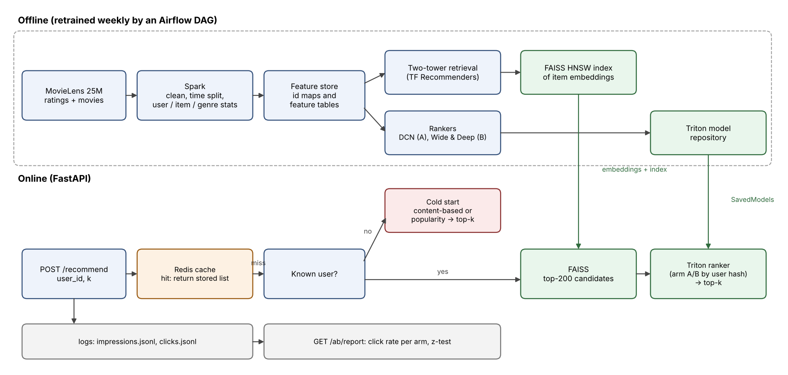

# Two-stage movie recommender (MovieLens)

## Current verified status — 20 November 2026

- Latest small-dataset run: 17 evaluated users. NDCG@20 was 0.1154 for retrieval alone, 0.1174 for retrieval + DCN, and 0.1060 for retrieval + Wide & Deep.
- The Docker FastAPI service was tested successfully using the local Keras SavedModel backend, FAISS retrieval, Redis caching, and cold-start recommendations.
- Both Triton ranking models served successful direct inference requests. FastAPI-to-Triton integration was attempted but did not pass, so the working API uses Keras.
- Airflow DAG structure was checked, but scheduled Airflow execution and live-user A/B testing were not verified.
- Trained model weights are not stored in GitHub. They are preserved separately in the trained backup ZIP.


A recommendation pipeline in the style of large streaming and retail sites: a fast first stage picks a few hundred candidate movies for a user, and a slower, more precise second stage re-orders them. This repository covers the whole path from raw ratings to a small web service, and includes the evaluation and A/B-test code.

| Step | Tool |
|---|---|
| Clean, split by time, build user/item/genre features | Apache Spark (pandas fallback) |
| Candidate retrieval, user and item embeddings | Two-tower model, TensorFlow Recommenders |
| Nearest-neighbour search over item embeddings | FAISS (HNSW) |
| Re-ranking the candidates | Deep & Cross Network and Wide & Deep (TensorFlow) |
| New users without history | Content-based (genre) and popularity fallbacks |
| Caching of recommendation lists | Redis (in-memory fallback if Redis is not running) |
| Model serving | Triton Inference Server (or the SavedModels in-process) |
| Weekly retraining | Airflow DAG |
| Online experiment | Deterministic user split, CTR with z-test and bootstrap interval |

**Verified Colab runs (16 November 2026):** Both the `ml-latest-small` run and a separate `ml-25m`-source **2,000-user subset** completed. The small run had 85,710/8,067/7,059 train/validation/test ratings and 17 evaluated users; its best NDCG@20 was 0.1247 for retrieval + DCN. The larger-source subset processed **297,358 ratings** (252,623/23,782/20,953), evaluated 35 users, and had best NDCG@20 of **0.0959 for retrieval alone**; the rankers did not outperform retrieval on this measure. Neither experiment constitutes training on all 25M ratings. The small-run in-process `/recommend` demo succeeded with Redis caching and cold start. **Direct Triton inference was verified on 20 November. FastAPI-to-Triton integration, an Airflow scheduler and real-user A/B testing remain unverified.** See [small-run results](docs/RESULTS.md), [25M-subset results](docs/RESULTS_ML25M_SUBSET.md), [comparison](docs/RUN_COMPARISON.md), [verification](docs/VERIFICATION_STATUS.md) and [submission handoff](docs/SUBMISSION_HANDOFF.md).

**Presentation:** [10-minute PowerPoint](docs/Recommendation_Engine_10min.pptx) and [speaker outline](docs/PRESENTATION_OUTLINE.md).



## How the data is used

Ratings are split by time, not at random: everything up to the 85th percentile of the timestamps is training data, the next slice up to the 93rd percentile is validation, and the rest is the test period. A rating of 4 or higher counts as a positive. All statistics and models are fitted on the training period only. For serving and evaluation, the user features are recomputed from training plus validation history, and the test period is only used to score the results.

`configs/config.yaml` holds all settings. By default a random sample of 50,000 users is used so that a run fits on a free Colab GPU; set `data.max_users: null` to use all of them.

## Running it

### On Colab (recommended)

1. Open `notebooks/colab_pipeline.ipynb` in Colab and choose a GPU runtime.
2. Upload the repository as a zip (or put your GitHub URL into `GIT_URL`).
3. Run the cells in order. Start with `MODE = "small"`; the revised notebook stops on failed commands and tests `/recommend` with the FastAPI test client.
4. The final cell downloads a small `results_bundle.zip` with reports and documentation. It does **not** contain trained model weights, so it cannot by itself start the API on your Mac. Use the Colab API demo to record a working endpoint, and leave full mode until small mode has passed.

### On your own machine

```bash
pip install -r requirements.txt     # PySpark also needs Java
python scripts/smoke_test.py        # every stage on a tiny synthetic dataset
PYTHONPATH=src python -m recsys.cli all  # the real run, using configs/config.yaml
python scripts/make_report.py       # writes docs/RESULTS.md and reports/ndcg.png
```

Single stages: `python -m recsys.cli <download|split|features|train_retrieval|build_index|train_ranker|evaluate|ab_replay|export_triton>`.
Settings can be overridden per run, for example `--set retrieval.epochs=10 --engine pandas --dataset ml-latest-small`.

### Serving

```bash
PYTHONPATH=src uvicorn recsys.serving.api:app --port 8080
curl -X POST localhost:8080/recommend -H 'content-type: application/json' -d '{"user_id": 1, "k": 10}'
```

By default the rankers run inside the API process. To use Triton, run `PYTHONPATH=src python -m recsys.cli export_triton`, start the stack with `docker compose up redis triton`, and set `serving.backend: triton` in the config. `python scripts/check_triton.py` compares Triton's scores with the local model.

Triton's TensorFlow backend has to be the same TensorFlow version that exported the models, otherwise it may refuse to load them. `triton/model_repository/EXPORT_INFO.json` records the version used; pick the matching container tag with `TRITON_TAG`. Triton was successfully tested on this Apple-silicon Mac using image 24.05-py3; compatibility may vary by image and platform.

The endpoints are described in [docs/API.md](docs/API.md).

### Retraining with Airflow

Install Airflow in its own environment (its pinned dependencies clash with TensorFlow), copy `airflow/dags/recsys_retrain_dag.py` into the DAGs folder, and set `RECSYS_HOME` to the path of this repo. The DAG runs the stages above weekly and clears the Redis cache at the end.

## Evaluation

For every user with positive ratings in the test period, the recommenders produce a list that excludes movies the user already rated, and the list is compared with the movies the user rated 4 or higher in the test period. Reported: NDCG@K, Recall@K and hit rate for K = 10, 20, 50, for

- a popularity baseline,
- retrieval alone (the first 10/20/50 FAISS results),
- retrieval followed by each ranker (200 candidates re-scored).

It also reports how many of the exact-search candidates the HNSW index returns, retrieval time per user, and a separate cold-start comparison of popularity versus content-based recommendations for users who have no training history (their first three test-period ratings act as the seeds).

The A/B test (`ab_replay`) is a simulation: users are assigned to arm A (DCN) or arm B (Wide & Deep) by a hash, and clicks are sampled from their held-out positives with a position-bias model. It exercises the assignment, logging-format and statistics code, but it says nothing about real user behaviour. With real traffic the API writes `logs/impressions.jsonl` and `logs/clicks.jsonl`, and `GET /ab/report` computes the same statistics from them.

Results of a run end up in `reports/metrics.json` and `reports/ab_replay.json`, and `scripts/make_report.py` turns them into `docs/RESULTS.md`. Commit that file after your run so the results are part of the repository.

## Tests

`make test` runs the unit tests. They cover the time split, feature tables, metrics, the nearest-neighbour search (numpy path), cold start, the recommender with the cache, the evaluation loop, the A/B statistics, the config handling and the Triton repository layout. They do not need TensorFlow.

The parts that need TensorFlow, FAISS, Spark, Redis or Triton are covered by `scripts/smoke_test.py`, which runs every stage on synthetic data and checks the online recommender. It has to be run on a machine with those packages installed (the Colab notebook does this in step 3).

For the current handover and verification scope, see [Verification status](docs/VERIFICATION_STATUS.md).

## Known limitations

- The user feature tables used while training include the rating being predicted, a small leak that only affects training. Evaluation is unaffected because the test period is held out by time.
- A rating of 4 or higher stands in for a click; MovieLens has no real click data.
- Users are subsampled by default, so absolute numbers are not comparable with results on the full dataset.
- The candidate search excludes already-seen movies by over-fetching, which gets slower for users with thousands of ratings.

## Data

MovieLens is provided by GroupLens for research use. The download script fetches it into `data/raw/`; it is not part of the repository.
