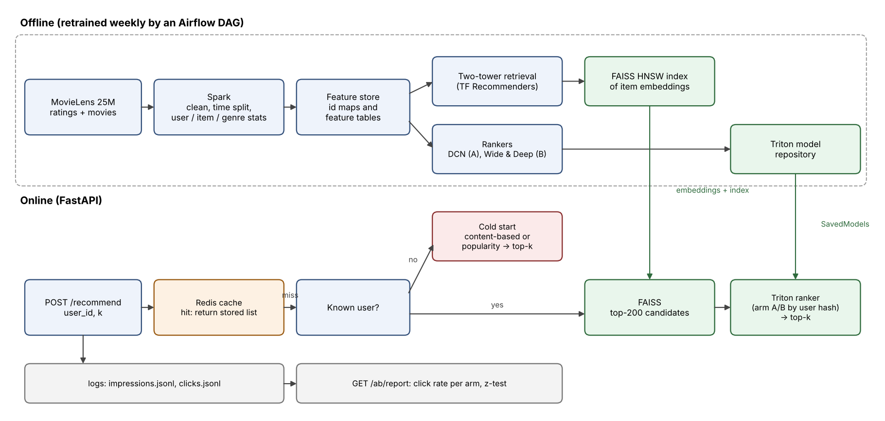

# Architecture notes

## Offline
1. **Spark** reads the ratings, drops duplicates and users with fewer than 20 ratings, optionally samples users, splits by time and writes the training tables: per-user and per-item rating statistics and per-user genre counts. `recsys.data.split` produces the same tables with pandas.
2. **Feature store** (`recsys/features.py`) turns those tables into numpy arrays: id maps (row 0 is for unknown ids), item genre vectors, user/item statistics, item popularity.
3. **Retrieval**: each tower takes an id, adds a learned embedding to the frozen feature rows and passes both through a small MLP; outputs are L2-normalised. The loss is an in-batch softmax with a correction for how often each item appears as a positive.
4. **Index**: item embeddings go into a FAISS HNSW index (inner product, which equals cosine similarity here).
5. **Rankers**: DCN (two cross layers plus an MLP) and Wide & Deep, trained on observed ratings (label: rating >= 4) plus unseen movies sampled by popularity as extra negatives. Validation uses the validation period.
6. **Export**: both rankers are saved as SavedModels and copied into a Triton model repository.

The models take only integer ids; the feature tables are frozen layers inside the saved models. That keeps the serving interface to two int tensors, `user_idx` and `item_idx`.

## Online
`Recommender.recommend` first checks the cache (the key contains model version, arm, user, `k` and any seeds). A known user's embedding is looked up, FAISS returns the top 200 unseen movies, and the user's arm decides which ranker re-scores them. Unknown users get a genre-based list from their seed movies or liked genres, or the popularity list. Results are cached for ten minutes.

The arm comes from a SHA-256 hash of the experiment name and the user id, so a user always gets the same ranker.

## Choices worth explaining in the review
- Why two stages: scoring every movie for every user with the ranker would be far too slow; the embedding search narrows 60k movies to 200 in milliseconds.
- Why a time split: a random split lets the model see later ratings of the same user, which overstates quality.
- Why the logQ correction: with in-batch negatives, popular movies are over-represented as negatives, and the correction stops the model from simply learning to avoid them.
- Why `max_batch_size: 0` for Triton: the models already take a whole list of candidates in one request.
